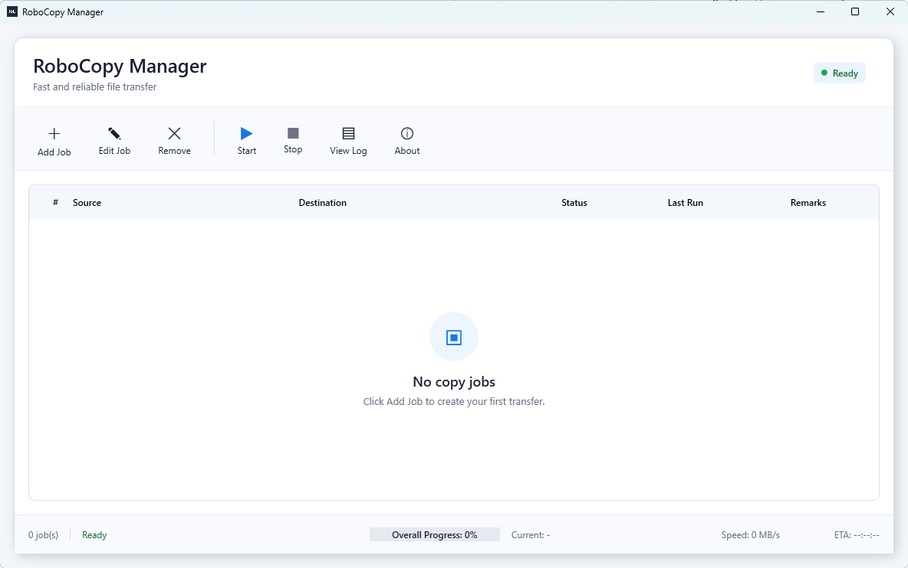
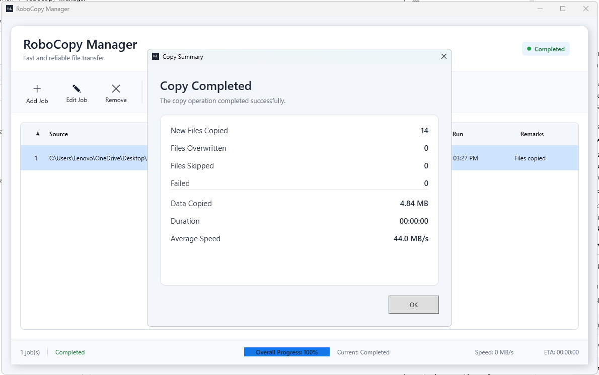
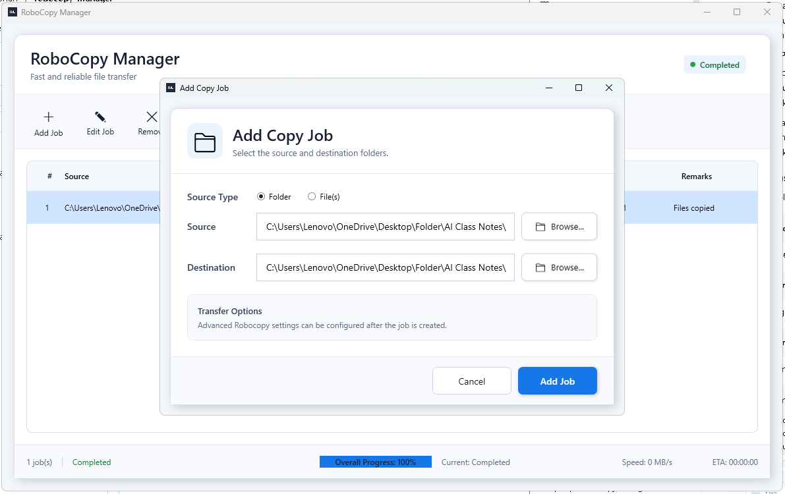

# RoboCopyManager

**A Windows desktop application for managing Robocopy file transfer jobs.**

RoboCopyManager is a Windows WPF application designed to simplify the management and monitoring of file transfer operations using Robocopy.

## Features

* **Job Management** — Manage and organize file transfer jobs.
* **Copy Progress Monitoring** — Monitor file transfer progress during copy operations.
* **Transfer Speed Statistics** — View transfer speed and copy operation statistics.
* **Windows Desktop Application** — Built using C# and Windows Presentation Foundation (WPF).
* **Installer Support** — Install the application under Program Files with administrator privileges.

## Screenshots

### Main Window

The main dashboard for managing and monitoring Robocopy jobs.

### Copy Summary

View copy results, including files copied, overwritten, skipped, failed, total data transferred, duration, and average transfer speed.

### Add Copy Job

Configure source and destination folders when creating a new copy job.

## Installation

1. Visit the [Releases](https://github.com/marwanshah/robocopy-manager/releases) page.
2. Download `RoboCopyManager-Setup.exe` from the latest release.
3. Run the installer.
4. Follow the installation instructions.
5. Launch RoboCopyManager.

> Note: Windows may display a security warning for unsigned applications. Only run installers obtained from a trusted source.

## Technology Stack

* C#
* .NET / WPF
* Robocopy
* PowerShell

## Developer

**Marwan Shah**

GitHub: [@marwanshah](https://github.com/marwanshah)

## License

No license has been specified yet. All rights are reserved by the copyright holder unless otherwise stated.
